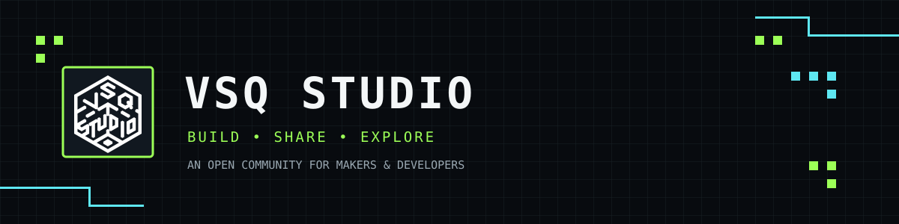

<div align="center">



**[简体中文](README.md) · [English](README.en.md)**

</div>

<div align="center">

### `> BUILD. SHARE. EXPLORE._`

**VSQ Studio is an open collaboration space for makers and developers.**

Explore ideas, build useful tools, share what you make, and help great projects grow.

[Organization](https://github.com/VSQ-Studio) · [Repositories](https://github.com/orgs/VSQ-Studio/repositories) · [Contribute](https://github.com/VSQ-Studio/.github/blob/main/CONTRIBUTING.md)

</div>

---

## `01 / WHO WE ARE`

We believe great work comes from curiosity and open collaboration. VSQ Studio explores software, tools, and creative technology. Developers from all backgrounds are welcome to turn ideas into useful things together.

```text
┌────────────────────────────────────────────────────────────┐
│  OPEN SOURCE     ██████████   Share knowledge              │
│  COLLABORATION   ██████████   Build together               │
│  EXPERIMENT      ██████████   Keep exploring               │
└────────────────────────────────────────────────────────────┘
```

## `02 / COMMUNITY CONTRIBUTIONS`

**A community is built through every issue, pull request, code review, and documentation improvement.**

Start small: report a bug, suggest an idea, improve a guide, or submit code. The contributor panels below are generated from public repository contribution data. They may take a moment to load.

### Contributors · XQSL_PyQt
[View contribution history →](https://github.com/VSQ-Studio/XQSL_PyQt/graphs/contributors)


### Contributors · JTTY-Go
[View contribution history →](https://github.com/VSQ-Studio/JTTY-Go/graphs/contributors)


### Contributors · SATSSTV-Go
[View contribution history →](https://github.com/VSQ-Studio/SATSSTV-Go/graphs/contributors)


### Contributors · SATAprs-Go
[View contribution history →](https://github.com/VSQ-Studio/SATAprs-Go/graphs/contributors)


### Contributors · IC-9700-Remote-Control-Switch
[View contribution history →](https://github.com/VSQ-Studio/IC-9700-Remote-Control-Switch/graphs/contributors)


### Contributors · OrbitTLM
[View contribution history →](https://github.com/VSQ-Studio/OrbitTLM/graphs/contributors)


### Ways to contribute

| Path | How you can help |
|:--|:--|
| `ISSUES` | Report bugs, share ideas, and discuss improvements |
| `PULL REQUESTS` | Submit code, fix bugs, and improve features |
| `DOCUMENTATION` | Improve READMEs, tutorials, and guides |
| `CODE REVIEW` | Test changes, review code, and share feedback |

<div align="center">

**[Explore repositories and start contributing →](https://github.com/orgs/VSQ-Studio/repositories)**

</div>

---

## `03 / GITHUB ACTIVITY`

A live view of the organization's public activity and contribution trends. The graph is generated dynamically by GitHub Activity Graph; caching and update delays may apply.

<div align="center">


</div>

<div align="center">

[Organization activity →](https://github.com/orgs/VSQ-Studio/activity) · [Repository updates →](https://github.com/orgs/VSQ-Studio/repositories)

</div>

---

## `04 / JOIN THE STUDIO`

Whether you are a developer, designer, documentation contributor, or simply curious about what we're building, you're welcome at VSQ Studio.

- ⭐ Star repositories you find useful
- 🐛 Open an issue to report a problem or suggest an idea
- 🔧 Improve a project through pull requests
- 💬 Join discussions and help the community grow

<div align="center">

### `> THANKS FOR BUILDING WITH US._`

**Made with curiosity. Improved by community.**

[VSQ Studio on GitHub](https://github.com/VSQ-Studio)

</div>
