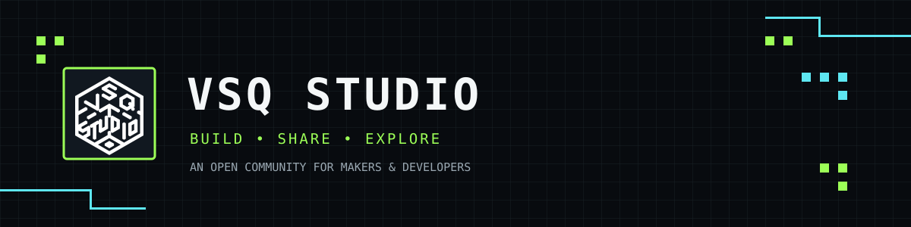

<div align="center">



**[简体中文](README.md) · [English](README.en.md)**

</div>

<div align="center">

### `> BUILD. SHARE. EXPLORE._`

**VSQ Studio 是一个面向创作者与开发者的开源协作空间。**

探索想法，构建工具，分享成果，让有趣的项目持续生长。

[组织主页](https://github.com/VSQ-Studio) · [全部仓库](https://github.com/orgs/VSQ-Studio/repositories) · [参与贡献](https://github.com/VSQ-Studio/.github/blob/main/CONTRIBUTING.md)

</div>

---

## `01 / WHO WE ARE`

我们相信好的作品来自持续探索与开放协作。VSQ Studio 关注软件、工具与创意技术，欢迎不同背景的开发者加入，一起把想法变成可用的作品。

```text
┌────────────────────────────────────────────────────────────┐
│  OPEN SOURCE     ██████████   Share knowledge              │
│  COLLABORATION   ██████████   Build together               │
│  EXPERIMENT      ██████████   Keep exploring               │
└────────────────────────────────────────────────────────────┘
```

## `02 / COMMUNITY CONTRIBUTIONS`

**社区由每一次 Issue、Pull Request、代码评审和文档改进共同构成。**

欢迎从一个小问题开始参与。下面的贡献者面板由公开仓库的贡献记录生成；首次加载可能需要一点时间。

### Contributors · XQSL_PyQt
[查看贡献记录 →](https://github.com/VSQ-Studio/XQSL_PyQt/graphs/contributors)


### Contributors · JTTY-Go
[查看贡献记录 →](https://github.com/VSQ-Studio/JTTY-Go/graphs/contributors)


### Contributors · SATSSTV-Go
[查看贡献记录 →](https://github.com/VSQ-Studio/SATSSTV-Go/graphs/contributors)


### Contributors · SATAprs-Go
[查看贡献记录 →](https://github.com/VSQ-Studio/SATAprs-Go/graphs/contributors)


### Contributors · IC-9700-Remote-Control-Switch
[查看贡献记录 →](https://github.com/VSQ-Studio/IC-9700-Remote-Control-Switch/graphs/contributors)


### Contributors · OrbitTLM
[查看贡献记录 →](https://github.com/VSQ-Studio/OrbitTLM/graphs/contributors)


### How to contribute

| 方式 | 你可以做什么 |
|:--|:--|
| `ISSUES` | 报告 Bug、提出想法、讨论改进方向 |
| `PULL REQUESTS` | 提交代码、修复问题、完善功能 |
| `DOCUMENTATION` | 改进 README、教程和使用说明 |
| `CODE REVIEW` | 帮助测试、审查代码并提出建议 |

<div align="center">

**[浏览所有仓库并开始贡献 →](https://github.com/orgs/VSQ-Studio/repositories)**

</div>

---

## `03 / GITHUB ACTIVITY`

组织的公开活动与贡献趋势。图表由 GitHub Activity Graph 服务动态生成，数据可能存在缓存或更新延迟。

<div align="center">


</div>

<div align="center">

[GitHub 组织动态 →](https://github.com/orgs/VSQ-Studio/activity) · [仓库更新 →](https://github.com/orgs/VSQ-Studio/repositories)

</div>

---

## `04 / JOIN THE STUDIO`

不论你是开发者、设计者、文档贡献者，还是单纯对项目感兴趣，都欢迎来到 VSQ Studio。

- ⭐ 给你喜欢的仓库点 Star
- 🐛 提交 Issue，分享问题或建议
- 🔧 通过 Pull Request 一起改进项目
- 💬 参与讨论，帮助社区变得更好

<div align="center">

### `> THANKS FOR BUILDING WITH US._`

**Made with curiosity. Improved by community.**

[VSQ Studio on GitHub](https://github.com/VSQ-Studio)

</div>
