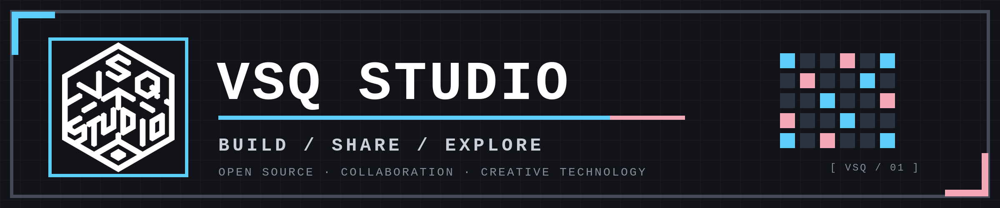

  <a href="README.md">简体中文</a> · <strong>English</strong>

  <picture>
    <source media="(prefers-color-scheme: dark)" srcset="assets/pixel-header-dark.png" />
    <source media="(prefers-color-scheme: light)" srcset="assets/pixel-header-light.png" />
    
  </picture>

  
  

## `01 / ABOUT VSQ STUDIO`

VSQ Studio is an open-source collaboration space for creators and developers, with a focus on software, tools, and creative technology.

We believe good work grows through continuous exploration and open collaboration. Explore ideas, build tools, share what you make, and help interesting projects grow.

  <code>OPEN SOURCE</code>　 <code>COLLABORATION</code>　 <code>EXPERIMENT</code>

## `02 / COMMUNITY CONTRIBUTIONS`

  <picture>
    <source media="(prefers-color-scheme: dark)" srcset="https://github-profile-summary-cards.vercel.app/api/cards/stats?username=VSQ-Studio&theme=github_dark" />
    <source media="(prefers-color-scheme: light)" srcset="https://github-profile-summary-cards.vercel.app/api/cards/stats?username=VSQ-Studio&theme=github" />
    
  </picture>
  <picture>
    <source media="(prefers-color-scheme: dark)" srcset="https://github-profile-summary-cards.vercel.app/api/cards/repos-per-language?username=VSQ-Studio&theme=github_dark" />
    <source media="(prefers-color-scheme: light)" srcset="https://github-profile-summary-cards.vercel.app/api/cards/repos-per-language?username=VSQ-Studio&theme=github" />
    
  </picture>
  <picture>
    <source media="(prefers-color-scheme: dark)" srcset="https://github-profile-summary-cards.vercel.app/api/cards/most-commit-language?username=VSQ-Studio&theme=github_dark" />
    <source media="(prefers-color-scheme: light)" srcset="https://github-profile-summary-cards.vercel.app/api/cards/most-commit-language?username=VSQ-Studio&theme=github" />
    
  </picture>

  These cards aggregate VSQ-Studio public repositories and automatically adapt to the current GitHub color theme.

## `03 / GITHUB ACTIVITY`

  <picture>
    <source media="(prefers-color-scheme: dark)" srcset="assets/org-contribution-calendar-dark.svg" />
    <source media="(prefers-color-scheme: light)" srcset="assets/org-contribution-calendar.svg" />
    
  </picture>

  <picture>
    <source media="(prefers-color-scheme: dark)" srcset="https://github-profile-summary-cards.vercel.app/api/cards/profile-details?username=VSQ-Studio&amp;theme=github_dark" />
    <source media="(prefers-color-scheme: light)" srcset="https://github-profile-summary-cards.vercel.app/api/cards/profile-details?username=VSQ-Studio&amp;theme=github" />
    
  </picture>

  The calendar aggregates daily commits on the default branches of VSQ-Studio public, non-fork project repositories using UTC dates. The .github repository that stores this profile and calendar is excluded to prevent automated asset updates from inflating activity. The Profile Details card uses organization mode and shows the repository creation timeline, not a personal contribution graph.

## `04 / CONTRIBUTE TO DEVELOPMENT`

Developers, designers, and documentation contributors are welcome. Choose a repository that interests you, start with an Issue or discussion, suggest an improvement, or open a Pull Request to contribute.

  

  <strong><code>&gt; BUILD TOGETHER. GROW TOGETHER._</code></strong> 
  Made with curiosity. Improved by community.

