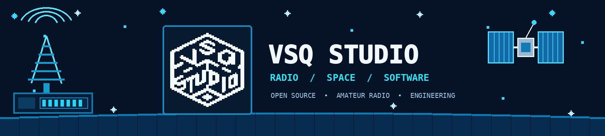
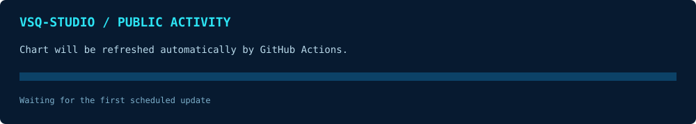

  

  <a href="README.md">简体中文</a>　|　<a href="README.en.md">English</a>

  <strong>Make radio and satellite technology simpler. Connect more explorers through open source.</strong>

  
  

---

## ▣ ABOUT VSQ STUDIO

**VSQ-Studio** is an open-source collaboration organization focused on radio, satellite communications, and engineering software. We turn complex communication technologies into practical, reproducible, and continuously improving tools through software, hardware, and hands-on engineering.

We value open collaboration, engineering reliability, cross-platform usability, and knowledge sharing. Our work spans radio-operation utilities, satellite-data processing, and embedded systems.

## ▣ OUR FOCUS

<table>
<tr>
<td width="50%" valign="top">

### 📡 Radio Communications
Amateur radio, digital modes, ground-station utilities, and radio-control software.

</td>
<td width="50%" valign="top">

### 🛰️ Satellite & Space
Satellite telemetry, orbital information, satellite communications, and space-data applications.

</td>
</tr>
<tr>
<td width="50%" valign="top">

### 💻 Software Engineering
Cross-platform desktop and mobile apps, automation tools, and developer infrastructure.

</td>
<td width="50%" valign="top">

### 🔧 Electronics & Embedded
Radio hardware, embedded systems, interface design, and hardware/software integration.

</td>
</tr>
</table>

## ▣ TECHNOLOGY

  

## ▣ GITHUB ACTIVITY

  
  
  

The chart is refreshed every six hours by GitHub Actions and summarizes public events returned by the GitHub Organization Events API for the last 14 days. It represents public activity only—not private-repository activity or real-time online presence.

## ▣ COMMUNITY & CONTRIBUTIONS

We welcome radio amateurs, developers, electronics engineers, satellite enthusiasts, and documentation contributors.

| How to contribute | Ways to help |
|---|---|
| 🐛 **Report an issue** | Include reproducible steps, logs, screenshots, and environment details |
| 🧩 **Contribute code** | Fix bugs, build features, and submit pull requests |
| 📖 **Improve docs** | Help with guides, examples, translations, and Chinese/English documentation |
| 🧪 **Test & review** | Test across operating systems, devices, and radio setups |
| 💡 **Share ideas** | Discuss use cases, feature requests, and technical approaches |

**Suggested workflow:** Read the target repository's README, Issues, Discussions, and contribution guide. For substantial changes, open an Issue first to discuss the design. Pull requests should explain the motivation, testing performed, and potential impact.

- [Browse organization repositories](https://github.com/orgs/VSQ-Studio/repositories)
- [Join organization discussions](https://github.com/orgs/VSQ-Studio/discussions)
- [Explore open issues](https://github.com/orgs/VSQ-Studio/issues)

---

  
   VSQ-STUDIO · BUILD / INNOVATE / SHARE 
  Making radio and space technology more accessible through open source.

