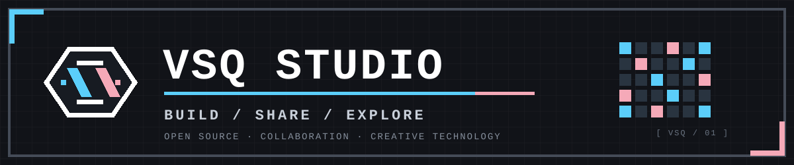

  <strong>简体中文</strong> · <a href="README.en.md">English</a>

  <picture>
    <source media="(prefers-color-scheme: dark)" srcset="assets/pixel-header-dark.svg" />
    <source media="(prefers-color-scheme: light)" srcset="assets/pixel-header-light.svg" />
    
  </picture>

  
  

## `01 / 关于 VSQ STUDIO`

VSQ Studio 是一个面向创作者与开发者的开源协作空间，关注软件、工具与创意技术。

我们相信好的作品来自持续探索与开放协作。探索想法、构建工具、分享成果，让有趣的项目持续生长。

  <code>OPEN SOURCE</code>　 <code>COLLABORATION</code>　 <code>EXPERIMENT</code>

## `02 / 社区贡献`

  
  
  

  

## `03 / GITHUB 活动`

  <picture>
    <source media="(prefers-color-scheme: dark)" srcset="https://raw.githubusercontent.com/VSQ-Studio/.github/output/org-contribution-calendar-dark.svg" />
    <source media="(prefers-color-scheme: light)" srcset="https://raw.githubusercontent.com/VSQ-Studio/.github/output/org-contribution-calendar.svg" />
    
  </picture>

  组织级贡献日历由 GitHub Actions 自动生成：汇总 VSQ-Studio 所有公开、非 Fork 仓库默认分支中的提交记录，按 UTC 日期统计最近 365 天的活动。不依赖任何维护者个人账号。

## `04 / 加入 VSQ STUDIO`

无论你是开发者、设计者、文档贡献者，还是单纯对项目感兴趣，都欢迎浏览我们的开源项目，并通过 Issue 或 Pull Request 参与改进。

  
  

  <strong><code>> THANKS FOR BUILDING WITH US._</code></strong> 
  Made with curiosity. Improved by community.

